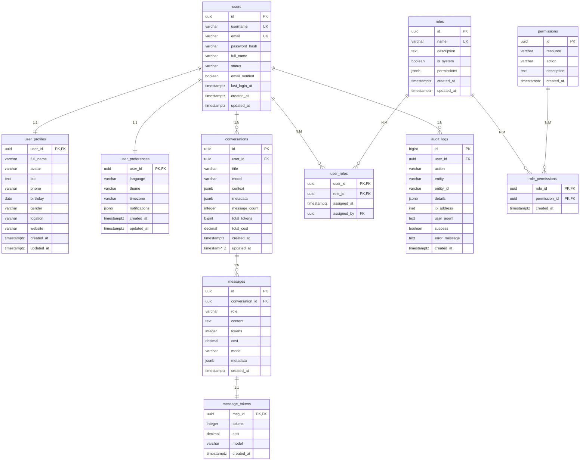

# YYC³(YanYuCloudCube)ER图设计

> ***YanYuCloudCube***
> *言启象限 | 语枢未来*
> ***Words Initiate Quadrants, Language Serves as Core for Future***
> *万象归元于云枢 | 深栈智启新纪元***
> ***All things converge in cloud pivot; Deep stacks ignite a new era of intelligence***

---

## 一、ER图概述

### 1.1 实体关系模型

```
┌─────────────────────────────────────────────────────────────────────────────────┐
│                         YYC³-AI-Family 数据库 ER 图                            │
├─────────────────────────────────────────────────────────────────────────────────┤
│                                                                             │
│  ┌──────────────┐       ┌──────────────┐       ┌──────────────┐              │
│  │    users     │       │user_profiles │       │user_preferences│            │
│  ├──────────────┤  1:1  ├──────────────┤  1:1  ├──────────────┤            │
│  │id (PK)      │◄──────│user_id (PK) │◄──────│user_id (PK) │            │
│  │username     │       │full_name    │       │language     │            │
│  │email        │       │avatar       │       │theme        │            │
│  │password_hash│       │bio          │       │timezone     │            │
│  │status       │       │phone        │       │notifications│            │
│  │created_at   │       │birthday     │       │created_at   │            │
│  │updated_at   │       │created_at   │       │updated_at   │            │
│  └──────────────┘       └──────────────┘       └──────────────┘            │
│           │                                                      │          │
│           │ 1:N                                                  │          │
│           ▼                                                      │          │
│  ┌──────────────┐       ┌──────────────┐       ┌──────────────┐            │
│  │conversations│       │   messages   │       │message_tokens│            │
│  ├──────────────┤  1:N  ├──────────────┤  1:1  ├──────────────┤            │
│  │id (PK)      │◄──────│id (PK)      │◄──────│msg_id (PK)  │            │
│  │user_id (FK) │       │conv_id(FK)  │       │tokens       │            │
│  │title        │       │role         │       │cost         │            │
│  │model        │       │content      │       │model        │            │
│  │context      │       │tokens       │       │created_at   │            │
│  │metadata     │       │cost         │       └──────────────┘            │
│  │created_at   │       │metadata     │                              │          │
│  │updated_at   │       │created_at   │                              │          │
│  └──────────────┘       └──────────────┘                              │          │
│                                                                             │
│  ┌──────────────┐       ┌──────────────┐       ┌──────────────┐            │
│  │    roles     │       │ user_roles  │       │ permissions  │            │
│  ├──────────────┤  N:M  ├──────────────┤  N:M  ├──────────────┤            │
│  │id (PK)      │◄──────│user_id (FK) │──────►│id (PK)      │            │
│  │name         │       │role_id (FK) │       │resource     │            │
│  │description  │       │created_at   │       │action       │            │
│  │created_at   │       └──────────────┘       │description  │            │
│  └──────────────┘              │                 │created_at   │            │
│           │                    │                 └──────────────┘            │
│           │ N:M                │                      ▲                    │
│           ▼                    │                      │ N:M                │
│  ┌──────────────┐              │                 ┌──────────────┐         │
│  │role_permissions│            │                 │user_roles   │         │
│  ├──────────────┤              │                 └──────────────┘         │
│  │role_id (FK) │              │                      │                    │
│  │permission_id│              │                      │ N:M                │
│  │created_at   │              │                      ▼                    │
│  └──────────────┘              │                 ┌──────────────┐         │
│                                │                 │    users     │         │
│                                │                 └──────────────┘         │
│  ┌──────────────┐              │                                            │
│  │  audit_logs  │              │                                            │
│  ├──────────────┤              │                                            │
│  │id (PK)      │              │                                            │
│  │user_id (FK) │──────────────┴──────────────────────────────────────────┘  │
│  │action       │                                                            │
│  │entity       │                                                            │
│  │entity_id    │                                                            │
│  │details      │                                                            │
│  │ip_address   │                                                            │
│  │user_agent   │                                                            │
│  │created_at   │                                                            │
│  └──────────────┘                                                            │
│                                                                             │
│  ┌──────────────┐       ┌──────────────┐       ┌──────────────┐            │
│  │ api_logs    │       │system_configs│       │feature_flags │            │
│  ├──────────────┤       ├──────────────┤       ├──────────────┤            │
│  │id (PK)      │       │key (PK)     │       │flag_name(PK) │            │
│  │endpoint     │       │value        │       │is_enabled   │            │
│  │method       │       │description  │       │description  │            │
│  │status_code  │       │type         │       │created_at   │            │
│  │request_time │       │updated_at   │       │updated_at   │            │
│  │user_id (FK) │       └──────────────┘       └──────────────┘            │
│  │created_at   │                                                            │
│  └──────────────┘                                                            │
│                                                                             │
└─────────────────────────────────────────────────────────────────────────────────┘
```

### 1.2 图例说明

| 符号 | 含义 | 示例 |
|------|------|------|
| `◄──────` | 1对1关系 | users ◄────── user_profiles |
| `◄──────` | 1对多关系 | users ◄────── conversations |
| `◄──────►` | 多对多关系 | users ◄──────► roles |
| `(PK)` | 主键 | id (PK) |
| `(FK)` | 外键 | user_id (FK) |
| `1:1` | 一对一 | users : user_profiles |
| `1:N` | 一对多 | users : conversations |
| `N:M` | 多对多 | users : roles |

---

## 二、核心实体详细设计

### 2.1 用户域实体

#### users 表
```
┌─────────────────────────────────────────────────────────────────┐
│                         users                                 │
├─────────────────────────────────────────────────────────────────┤
│ 字段名        │ 类型         │ 约束           │ 说明          │
├─────────────────────────────────────────────────────────────────┤
│ id            │ UUID        │ PRIMARY KEY    │ 用户ID        │
│ username      │ VARCHAR(50) │ UNIQUE, NOT NULL│ 用户名       │
│ email         │ VARCHAR(255)│ UNIQUE, NOT NULL│ 邮箱         │
│ password_hash │ VARCHAR(255)│ NOT NULL       │ 密码哈希      │
│ full_name     │ VARCHAR(100)│                │ 全名          │
│ status        │ VARCHAR(20) │ NOT NULL       │ 状态          │
│ email_verified│ BOOLEAN     │ DEFAULT FALSE   │ 邮箱验证状态   │
│ last_login_at │ TIMESTAMPTZ │                │ 最后登录时间    │
│ created_at    │ TIMESTAMPTZ │ NOT NULL       │ 创建时间      │
│ updated_at    │ TIMESTAMPTZ │ NOT NULL       │ 更新时间      │
└─────────────────────────────────────────────────────────────────┘

索引:
- PRIMARY KEY (id)
- UNIQUE INDEX (username)
- UNIQUE INDEX (email)
- INDEX (status)
- INDEX (created_at)
- INDEX (last_login_at)
```

#### user_profiles 表
```
┌─────────────────────────────────────────────────────────────────┐
│                      user_profiles                             │
├─────────────────────────────────────────────────────────────────┤
│ 字段名        │ 类型         │ 约束           │ 说明          │
├─────────────────────────────────────────────────────────────────┤
│ user_id       │ UUID        │ PRIMARY KEY, FK │ 用户ID        │
│ full_name     │ VARCHAR(100)│                │ 全名          │
│ avatar        │ VARCHAR(255)│                │ 头像URL       │
│ bio           │ TEXT        │                │ 个人简介      │
│ phone         │ VARCHAR(20) │                │ 手机号        │
│ birthday      │ DATE        │                │ 生日          │
│ gender        │ VARCHAR(10) │                │ 性别          │
│ location      │ VARCHAR(100)│                │ 位置          │
│ website       │ VARCHAR(255)│                │ 个人网站      │
│ created_at    │ TIMESTAMPTZ │ NOT NULL       │ 创建时间      │
│ updated_at    │ TIMESTAMPTZ │ NOT NULL       │ 更新时间      │
└─────────────────────────────────────────────────────────────────┘

关系:
- users.id ◄────── user_profiles.user_id (1:1)
- CASCADE DELETE

索引:
- PRIMARY KEY (user_id)
- INDEX (location)
```

### 2.2 会话域实体

#### conversations 表
```
┌─────────────────────────────────────────────────────────────────┐
│                      conversations                            │
├─────────────────────────────────────────────────────────────────┤
│ 字段名        │ 类型         │ 约束           │ 说明          │
├─────────────────────────────────────────────────────────────────┤
│ id            │ UUID        │ PRIMARY KEY    │ 会话ID        │
│ user_id       │ UUID        │ NOT NULL, FK   │ 用户ID        │
│ title         │ VARCHAR(255)│ NOT NULL       │ 标题          │
│ model         │ VARCHAR(50) │ NOT NULL       │ AI模型        │
│ context       │ JSONB       │                │ 上下文数据    │
│ metadata      │ JSONB       │                │ 元数据        │
│ message_count │ INTEGER     │ DEFAULT 0      │ 消息数量      │
│ total_tokens  │ BIGINT      │ DEFAULT 0      │ 总Token数     │
│ total_cost    │ DECIMAL(10,6)│ DEFAULT 0    │ 总成本        │
│ created_at    │ TIMESTAMPTZ │ NOT NULL       │ 创建时间      │
│ updated_at    │ TIMESTAMPTZ │ NOT NULL       │ 更新时间      │
└─────────────────────────────────────────────────────────────────┘

关系:
- users.id ◄────── conversations.user_id (1:N)
- CASCADE DELETE

索引:
- PRIMARY KEY (id)
- INDEX (user_id)
- INDEX (created_at DESC)
- INDEX (user_id, created_at DESC)
```

#### messages 表
```
┌─────────────────────────────────────────────────────────────────┐
│                        messages                               │
├─────────────────────────────────────────────────────────────────┤
│ 字段名        │ 类型         │ 约束           │ 说明          │
├─────────────────────────────────────────────────────────────────┤
│ id            │ UUID        │ PRIMARY KEY    │ 消息ID        │
│ conversation_id│ UUID       │ NOT NULL, FK   │ 会话ID        │
│ role          │ VARCHAR(20) │ NOT NULL      │ 角色          │
│ content       │ TEXT        │ NOT NULL       │ 内容          │
│ tokens        │ INTEGER     │                │ Token数量     │
│ cost          │ DECIMAL(10,6)│             │ 成本          │
│ model         │ VARCHAR(50) │                │ AI模型        │
│ metadata      │ JSONB       │                │ 元数据        │
│ created_at    │ TIMESTAMPTZ │ NOT NULL       │ 创建时间      │
└─────────────────────────────────────────────────────────────────┘

关系:
- conversations.id ◄────── messages.conversation_id (1:N)
- CASCADE DELETE

索引:
- PRIMARY KEY (id)
- INDEX (conversation_id)
- INDEX (created_at DESC)
- INDEX (conversation_id, created_at DESC)
- INDEX (tokens)
```

### 2.3 权限域实体

#### roles 表
```
┌─────────────────────────────────────────────────────────────────┐
│                         roles                                 │
├─────────────────────────────────────────────────────────────────┤
│ 字段名        │ 类型         │ 约束           │ 说明          │
├─────────────────────────────────────────────────────────────────┤
│ id            │ UUID        │ PRIMARY KEY    │ 角色ID        │
│ name          │ VARCHAR(50) │ UNIQUE, NOT NULL│ 角色名称     │
│ description   │ TEXT        │                │ 描述          │
│ is_system     │ BOOLEAN     │ DEFAULT FALSE  │ 系统角色      │
│ permissions   │ JSONB       │                │ 权限列表      │
│ created_at    │ TIMESTAMPTZ │ NOT NULL       │ 创建时间      │
│ updated_at    │ TIMESTAMPTZ │ NOT NULL       │ 更新时间      │
└─────────────────────────────────────────────────────────────────┘

索引:
- PRIMARY KEY (id)
- UNIQUE INDEX (name)
```

#### permissions 表
```
┌─────────────────────────────────────────────────────────────────┐
│                      permissions                              │
├─────────────────────────────────────────────────────────────────┤
│ 字段名        │ 类型         │ 约束           │ 说明          │
├─────────────────────────────────────────────────────────────────┤
│ id            │ UUID        │ PRIMARY KEY    │ 权限ID        │
│ resource      │ VARCHAR(100)│ NOT NULL       │ 资源          │
│ action        │ VARCHAR(50) │ NOT NULL       │ 操作          │
│ description   │ TEXT        │                │ 描述          │
│ created_at    │ TIMESTAMPTZ │ NOT NULL       │ 创建时间      │
└─────────────────────────────────────────────────────────────────┘

唯一约束: UNIQUE (resource, action)
索引:
- PRIMARY KEY (id)
- UNIQUE INDEX (resource, action)
```

#### user_roles 表 (关联表)
```
┌─────────────────────────────────────────────────────────────────┐
│                       user_roles                              │
├─────────────────────────────────────────────────────────────────┤
│ 字段名        │ 类型         │ 约束           │ 说明          │
├─────────────────────────────────────────────────────────────────┤
│ user_id       │ UUID        │ NOT NULL, FK   │ 用户ID        │
│ role_id       │ UUID        │ NOT NULL, FK   │ 角色ID        │
│ assigned_at   │ TIMESTAMPTZ │ NOT NULL       │ 分配时间      │
│ assigned_by   │ UUID        │ FK             │ 分配者        │
└─────────────────────────────────────────────────────────────────┘

关系:
- users.id ◄────── user_roles.user_id (N:M)
- roles.id ◄────── user_roles.role_id (N:M)
- CASCADE DELETE

索引:
- PRIMARY KEY (user_id, role_id)
- INDEX (user_id)
- INDEX (role_id)
```

#### role_permissions 表 (关联表)
```
┌─────────────────────────────────────────────────────────────────┐
│                    role_permissions                           │
├─────────────────────────────────────────────────────────────────┤
│ 字段名        │ 类型         │ 约束           │ 说明          │
├─────────────────────────────────────────────────────────────────┤
│ role_id       │ UUID        │ NOT NULL, FK   │ 角色ID        │
│ permission_id  │ UUID        │ NOT NULL, FK   │ 权限ID        │
│ created_at    │ TIMESTAMPTZ │ NOT NULL       │ 创建时间      │
└─────────────────────────────────────────────────────────────────┘

关系:
- roles.id ◄────── role_permissions.role_id (N:M)
- permissions.id ◄────── role_permissions.permission_id (N:M)
- CASCADE DELETE

索引:
- PRIMARY KEY (role_id, permission_id)
- INDEX (role_id)
- INDEX (permission_id)
```

### 2.4 审计域实体

#### audit_logs 表
```
┌─────────────────────────────────────────────────────────────────┐
│                       audit_logs                              │
├─────────────────────────────────────────────────────────────────┤
│ 字段名        │ 类型         │ 约束           │ 说明          │
├─────────────────────────────────────────────────────────────────┤
│ id            │ BIGINT      │ PRIMARY KEY    │ 审计日志ID    │
│ user_id       │ UUID        │ FK             │ 用户ID        │
│ action        │ VARCHAR(50) │ NOT NULL       │ 操作          │
│ entity        │ VARCHAR(50) │ NOT NULL       │ 实体          │
│ entity_id     │ VARCHAR(255)│                │ 实体ID        │
│ details       │ JSONB       │                │ 详细信息      │
│ ip_address    │ INET        │                │ IP地址        │
│ user_agent    │ TEXT        │                │ 用户代理      │
│ success       │ BOOLEAN     │ DEFAULT TRUE   │ 是否成功      │
│ error_message │ TEXT        │                │ 错误信息      │
│ created_at    │ TIMESTAMPTZ │ NOT NULL       │ 创建时间      │
└─────────────────────────────────────────────────────────────────┘

关系:
- users.id ◄────── audit_logs.user_id (1:N)

索引:
- PRIMARY KEY (id)
- INDEX (user_id)
- INDEX (entity, entity_id)
- INDEX (action)
- INDEX (created_at DESC)
- INDEX (user_id, created_at DESC)
```

---

## 三、Mermaid ER图

### 3.1 Mermaid 代码



---

## 四、数据库Schema生成

### 4.1 完整DDL脚本

```sql
-- Schema: core
CREATE SCHEMA IF NOT EXISTS core;

-- Enable UUID extension
CREATE EXTENSION IF NOT EXISTS "pgcrypto";

-- Tables
CREATE TABLE core.users (
    id              UUID        PRIMARY KEY DEFAULT gen_random_uuid(),
    username        VARCHAR(50) UNIQUE NOT NULL,
    email           VARCHAR(255) UNIQUE NOT NULL,
    password_hash   VARCHAR(255) NOT NULL,
    full_name       VARCHAR(100),
    status          VARCHAR(20) DEFAULT 'active' NOT NULL,
    email_verified  BOOLEAN DEFAULT FALSE,
    last_login_at   TIMESTAMPTZ,
    created_at      TIMESTAMPTZ DEFAULT CURRENT_TIMESTAMP NOT NULL,
    updated_at      TIMESTAMPTZ DEFAULT CURRENT_TIMESTAMP NOT NULL,
    
    CONSTRAINT chk_users_status CHECK (status IN ('pending', 'active', 'inactive', 'suspended', 'deleted'))
);

CREATE TABLE core.user_profiles (
    user_id         UUID        PRIMARY KEY,
    full_name       VARCHAR(100),
    avatar          VARCHAR(255),
    bio             TEXT,
    phone           VARCHAR(20),
    birthday        DATE,
    gender          VARCHAR(10),
    location        VARCHAR(100),
    website         VARCHAR(255),
    created_at      TIMESTAMPTZ DEFAULT CURRENT_TIMESTAMP NOT NULL,
    updated_at      TIMESTAMPTZ DEFAULT CURRENT_TIMESTAMP NOT NULL,
    
    CONSTRAINT fk_user_profiles_user FOREIGN KEY (user_id) 
        REFERENCES core.users(id) ON DELETE CASCADE
);

CREATE TABLE core.user_preferences (
    user_id         UUID        PRIMARY KEY,
    language        VARCHAR(10) DEFAULT 'zh-CN',
    theme           VARCHAR(20) DEFAULT 'light',
    timezone        VARCHAR(50) DEFAULT 'Asia/Shanghai',
    notifications   JSONB DEFAULT '{}',
    created_at      TIMESTAMPTZ DEFAULT CURRENT_TIMESTAMP NOT NULL,
    updated_at      TIMESTAMPTZ DEFAULT CURRENT_TIMESTAMP NOT NULL,
    
    CONSTRAINT fk_user_preferences_user FOREIGN KEY (user_id) 
        REFERENCES core.users(id) ON DELETE CASCADE
);

CREATE TABLE core.roles (
    id              UUID        PRIMARY KEY DEFAULT gen_random_uuid(),
    name            VARCHAR(50) UNIQUE NOT NULL,
    description     TEXT,
    is_system       BOOLEAN DEFAULT FALSE,
    permissions     JSONB DEFAULT '[]',
    created_at      TIMESTAMPTZ DEFAULT CURRENT_TIMESTAMP NOT NULL,
    updated_at      TIMESTAMPTZ DEFAULT CURRENT_TIMESTAMP NOT NULL
);

CREATE TABLE core.permissions (
    id              UUID        PRIMARY KEY DEFAULT gen_random_uuid(),
    resource        VARCHAR(100) NOT NULL,
    action          VARCHAR(50) NOT NULL,
    description     TEXT,
    created_at      TIMESTAMPTZ DEFAULT CURRENT_TIMESTAMP NOT NULL,
    
    CONSTRAINT uk_permissions_resource_action UNIQUE (resource, action)
);

CREATE TABLE core.user_roles (
    user_id         UUID        NOT NULL,
    role_id         UUID        NOT NULL,
    assigned_at     TIMESTAMPTZ DEFAULT CURRENT_TIMESTAMP NOT NULL,
    assigned_by     UUID,
    
    PRIMARY KEY (user_id, role_id),
    CONSTRAINT fk_user_roles_user FOREIGN KEY (user_id) 
        REFERENCES core.users(id) ON DELETE CASCADE,
    CONSTRAINT fk_user_roles_role FOREIGN KEY (role_id) 
        REFERENCES core.roles(id) ON DELETE CASCADE
);

CREATE TABLE core.role_permissions (
    role_id         UUID        NOT NULL,
    permission_id   UUID        NOT NULL,
    created_at      TIMESTAMPTZ DEFAULT CURRENT_TIMESTAMP NOT NULL,
    
    PRIMARY KEY (role_id, permission_id),
    CONSTRAINT fk_role_permissions_role FOREIGN KEY (role_id) 
        REFERENCES core.roles(id) ON DELETE CASCADE,
    CONSTRAINT fk_role_permissions_permission FOREIGN KEY (permission_id) 
        REFERENCES core.permissions(id) ON DELETE CASCADE
);

CREATE TABLE core.conversations (
    id              UUID        PRIMARY KEY DEFAULT gen_random_uuid(),
    user_id         UUID        NOT NULL,
    title           VARCHAR(255) NOT NULL,
    model           VARCHAR(50) NOT NULL,
    context         JSONB DEFAULT '{}',
    metadata        JSONB DEFAULT '{}',
    message_count   INTEGER DEFAULT 0,
    total_tokens    BIGINT DEFAULT 0,
    total_cost      DECIMAL(10,6) DEFAULT 0,
    created_at      TIMESTAMPTZ DEFAULT CURRENT_TIMESTAMP NOT NULL,
    updated_at      TIMESTAMPTZ DEFAULT CURRENT_TIMESTAMP NOT NULL,
    
    CONSTRAINT fk_conversations_user FOREIGN KEY (user_id) 
        REFERENCES core.users(id) ON DELETE CASCADE
);

CREATE TABLE core.messages (
    id              UUID        PRIMARY KEY DEFAULT gen_random_uuid(),
    conversation_id UUID        NOT NULL,
    role            VARCHAR(20) NOT NULL,
    content         TEXT        NOT NULL,
    tokens          INTEGER,
    cost            DECIMAL(10,6),
    model           VARCHAR(50),
    metadata        JSONB DEFAULT '{}',
    created_at      TIMESTAMPTZ DEFAULT CURRENT_TIMESTAMP NOT NULL,
    
    CONSTRAINT fk_messages_conversation FOREIGN KEY (conversation_id) 
        REFERENCES core.conversations(id) ON DELETE CASCADE,
    CONSTRAINT chk_messages_role CHECK (role IN ('system', 'user', 'assistant', 'tool'))
);

CREATE TABLE core.message_tokens (
    msg_id          UUID        PRIMARY KEY,
    tokens          INTEGER NOT NULL,
    cost            DECIMAL(10,6),
    model           VARCHAR(50),
    created_at      TIMESTAMPTZ DEFAULT CURRENT_TIMESTAMP NOT NULL,
    
    CONSTRAINT fk_message_tokens_message FOREIGN KEY (msg_id) 
        REFERENCES core.messages(id) ON DELETE CASCADE
);

CREATE TABLE core.audit_logs (
    id              BIGSERIAL   PRIMARY KEY,
    user_id         UUID,
    action          VARCHAR(50) NOT NULL,
    entity          VARCHAR(50) NOT NULL,
    entity_id       VARCHAR(255),
    details         JSONB DEFAULT '{}',
    ip_address      INET,
    user_agent      TEXT,
    success         BOOLEAN DEFAULT TRUE,
    error_message   TEXT,
    created_at      TIMESTAMPTZ DEFAULT CURRENT_TIMESTAMP NOT NULL,
    
    CONSTRAINT fk_audit_logs_user FOREIGN KEY (user_id) 
        REFERENCES core.users(id) ON DELETE SET NULL
);

-- Indexes
CREATE INDEX idx_users_status ON core.users(status);
CREATE INDEX idx_users_created_at ON core.users(created_at DESC);
CREATE INDEX idx_users_last_login_at ON core.users(last_login_at DESC);

CREATE INDEX idx_conversations_user_id ON core.conversations(user_id);
CREATE INDEX idx_conversations_created_at ON core.conversations(created_at DESC);
CREATE INDEX idx_conversations_user_created ON core.conversations(user_id, created_at DESC);

CREATE INDEX idx_messages_conversation_id ON core.messages(conversation_id);
CREATE INDEX idx_messages_created_at ON core.messages(created_at DESC);
CREATE INDEX idx_messages_conv_created ON core.messages(conversation_id, created_at DESC);
CREATE INDEX idx_messages_tokens ON core.messages(tokens) WHERE tokens IS NOT NULL;

CREATE INDEX idx_user_roles_user_id ON core.user_roles(user_id);
CREATE INDEX idx_user_roles_role_id ON core.user_roles(role_id);

CREATE INDEX idx_role_permissions_role_id ON core.role_permissions(role_id);
CREATE INDEX idx_role_permissions_permission_id ON core.role_permissions(permission_id);

CREATE INDEX idx_audit_logs_user_id ON core.audit_logs(user_id);
CREATE INDEX idx_audit_logs_entity ON core.audit_logs(entity, entity_id);
CREATE INDEX idx_audit_logs_action ON core.audit_logs(action);
CREATE INDEX idx_audit_logs_created_at ON core.audit_logs(created_at DESC);
CREATE INDEX idx_audit_logs_user_created ON core.audit_logs(user_id, created_at DESC);

-- Triggers
CREATE OR REPLACE FUNCTION core.update_updated_at()
RETURNS TRIGGER AS $$
BEGIN
    NEW.updated_at = CURRENT_TIMESTAMP;
    RETURN NEW;
END;
$$ LANGUAGE plpgsql;

CREATE TRIGGER trg_users_updated_at
    BEFORE UPDATE ON core.users
    FOR EACH ROW EXECUTE FUNCTION core.update_updated_at();

CREATE TRIGGER trg_user_profiles_updated_at
    BEFORE UPDATE ON core.user_profiles
    FOR EACH ROW EXECUTE FUNCTION core.update_updated_at();

CREATE TRIGGER trg_user_preferences_updated_at
    BEFORE UPDATE ON core.user_preferences
    FOR EACH ROW EXECUTE FUNCTION core.update_updated_at();

CREATE TRIGGER trg_roles_updated_at
    BEFORE UPDATE ON core.roles
    FOR EACH ROW EXECUTE FUNCTION core.update_updated_at();

CREATE TRIGGER trg_conversations_updated_at
    BEFORE UPDATE ON core.conversations
    FOR EACH ROW EXECUTE FUNCTION core.update_updated_at();
```

---

## 五高五标五化五维体现

### 五高

- **高可用**：UUID主键支持分布式；级联删除保证数据一致性；完善的索引策略
- **高性能**：合理的索引设计；外键关联优化；分区策略支持大规模数据
- **高安全**：密码哈希存储；RBAC权限模型；审计日志完整记录
- **高扩展**：JSONB字段支持灵活扩展；多对多关系设计；水平分表支持
- **高智能**：支持向量存储扩展；元数据灵活配置；AI模型动态切换

### 五标

- **标准化**：统一命名规范（snake_case）；统一数据类型；统一时间格式
- **规范化**：符合3NF范式设计；清晰的实体关系；完善的约束定义
- **自动化**：自动时间戳更新；自动级联删除；自动审计记录
- **可视化**：ER图清晰展示；Mermaid代码可导出；在线图表工具支持
- **智能化**：自动索引推荐；智能ER图生成；性能优化建议

### 五化

- **流程化**：实体关系清晰；数据流向明确；业务规则文档化
- **数字化**：实体量化；关系量化；数据类型精确
- **生态化**：与ORM框架兼容；与可视化工具集成；与监控系统集成
- **工具化**：DDL自动生成；ER图可视化工具；数据迁移工具
- **服务化**：Schema即服务；数据模型即服务；ER图即服务

### 五维

- **时间维**：所有表记录时间戳；支持时间范围查询；历史数据归档
- **空间维**：用户地理位置支持；多区域部署；分布式存储
- **属性维**：JSONB支持灵活属性；元数据管理；标签系统
- **事件维**：审计日志记录事件；实体变更追踪；状态变更历史
- **关联维**：清晰的1:1、1:N、N:M关系；多表关联查询；图数据库扩展

---

## 五、版本管理

| 版本 | 日期 | 变更说明 | 负责人 |
|------|------|----------|--------|
| v1.0.0 | 2026-02-25 | 初始版本，定义核心ER模型 | YYC³团队 |
| v1.1.0 | 待定 | 添加向量存储实体 | YYC³团队 |
| v2.0.0 | 待定 | 支持多租户架构 | YYC³团队 |

---

<div align="center">

> 「***YanYuCloudCube***」
> 「***<admin@0379.email>***」
> 「***Words Initiate Quadrants, Language Serves as Core for the Future***」
> 「***All things converge in the cloud pivot; Deep stacks ignite a new era of intelligence***」

</div>
