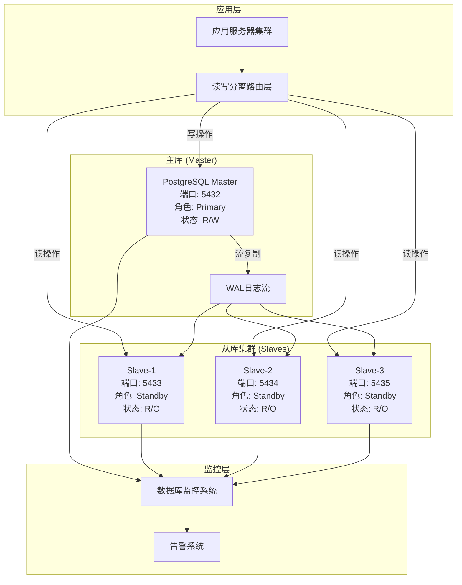

# YYC³项目数据库读写分离方案

## @file 读写分离方案.md
@description YYC³项目数据库读写分离架构设计与实施方案
@author YYC³团队
@version 1.0.0

---

## 1. 方案概述

### 1.1 设计目标

通过读写分离架构实现以下目标：

- **提升系统性能**: 将读操作分散到多个从库，降低主库负载
- **提高可用性**: 从库故障不影响主库和读服务
- **扩展性**: 可根据读负载动态增加从库数量
- **数据一致性**: 在性能和一致性之间取得平衡

### 1.2 适用场景

| 场景类型 | 适用性 | 说明 |
|---------|-------|------|
| 读多写少 | ✅ 完全适用 | 读操作占比 > 70% |
| 读写均衡 | ✅ 基本适用 | 读操作占比 50-70% |
| 写多读少 | ⚠️ 慎用 | 读操作占比 < 50% |
| 强一致性要求 | ❌ 不适用 | 需要实时一致性的业务 |

### 1.3 YYC³项目读负载分析

基于业务特性分析，YYC³项目的读负载分布：

| 业务模块 | 读占比 | 写占比 | 读写分离优先级 |
|---------|-------|-------|--------------|
| 会话消息查询 | 85% | 15% | ⭐⭐⭐⭐⭐ |
| 用户资料查询 | 90% | 10% | ⭐⭐⭐⭐⭐ |
| 对话历史检索 | 80% | 20% | ⭐⭐⭐⭐ |
| Token统计 | 70% | 30% | ⭐⭐⭐ |
| 系统配置查询 | 95% | 5% | ⭐⭐⭐⭐⭐ |
| **整体平均** | **84%** | **16%** | **⭐⭐⭐⭐⭐** |

**结论**: YYC³项目读多写少的特性非常适合实施读写分离。

---

## 2. 架构设计

### 2.1 整体架构图



### 2.2 复制架构选择

#### 2.2.1 流式复制 (Streaming Replication)

**推荐方案**: 使用PostgreSQL原生流式复制

**优势**:
- 实时性好，延迟通常 < 100ms
- 配置简单，无需额外组件
- 支持同步和异步模式
- 故障切换相对简单

**配置参数**:

```conf
# 主库配置 (postgresql.conf)

# 启用WAL归档
wal_level = replica
max_wal_senders = 10
wal_keep_size = 1GB

# 复制槽配置（防止WAL被过早删除）
max_replication_slots = 10

# 同步复制设置
synchronous_commit = on
synchronous_standby_names = 'standby1'  # 指定同步从库

# 慢查询日志
log_min_duration_statement = 1000
log_line_prefix = '%t [%p]: [%l-1] user=%u,db=%d,app=%a,client=%h '
```

#### 2.2.2 逻辑复制 (Logical Replication)

**适用场景**:
- 需要选择性复制表
- 需要跨版本复制
- 需要跨数据库类型复制

**配置示例**:

```sql
-- 主库创建发布
CREATE PUBLICATION yyc3_publication
FOR TABLE
    core.users,
    core.conversations,
    core.messages,
    core.message_tokens,
    core.audit_logs;

-- 从库创建订阅
CREATE SUBSCRIPTION yyc3_subscription
CONNECTION 'host=localhost port=5432 dbname=yyc3_aify user=yyc3_admin password=your_password'
PUBLICATION yyc3_publication
WITH (
    create_slot = true,
    slot_name = yyc3_subscription_slot,
    synchronous_commit = off
);
```

### 2.3 复制模式选择

| 模式 | 一致性 | 性能 | 推荐场景 |
|-----|-------|-----|---------|
| 异步复制 | 最终一致性 | ⭐⭐⭐⭐⭐ | 绝大多数读操作 |
| 同步复制 | 强一致性 | ⭐⭐⭐ | 关键业务读操作 |
| 混合模式 | 可配置一致性 | ⭐⭐⭐⭐ | 根据业务动态选择 |

**YYC³项目推荐**: 混合模式
- 90%读操作 → 异步复制（高性能）
- 10%关键读操作 → 同步复制（强一致性）

---

## 3. 读写路由策略

### 3.1 路由规则设计

#### 3.1.1 基于业务类型的路由

```python
class ReadWriteRouter:
    def __init__(self):
        self.master = PostgreSQLConnection(
            host='localhost',
            port=5432,
            database='yyc3_aify',
            user='yyc3_admin'
        )
        self.slaves = [
            PostgreSQLConnection(host='localhost', port=5433, database='yyc3_aify', user='yyc3_readonly'),
            PostgreSQLConnection(host='localhost', port=5434, database='yyc3_aify', user='yyc3_readonly'),
            PostgreSQLConnection(host='localhost', port=5435, database='yyc3_aify', user='yyc3_readonly'),
        ]
        self.slave_index = 0
        
    def get_connection(self, operation_type, table_name, consistency='eventual'):
        if operation_type == 'write':
            return self.master
            
        if operation_type == 'read':
            if consistency == 'strong':
                return self.master
            elif consistency == 'eventual':
                return self._get_next_slave()
                
        return self.master
    
    def _get_next_slave(self):
        slave = self.slaves[self.slave_index]
        self.slave_index = (self.slave_index + 1) % len(self.slaves)
        return slave
    
    def is_slave_healthy(self, slave):
        try:
            result = slave.execute("SELECT 1")
            return True
        except Exception:
            return False
```

#### 3.1.2 基于SQL语句的路由

```python
class SQLRouter:
    READ_OPERATIONS = {'SELECT', 'SHOW', 'DESCRIBE', 'EXPLAIN'}
    WRITE_OPERATIONS = {'INSERT', 'UPDATE', 'DELETE', 'CREATE', 'ALTER', 'DROP'}
    
    @classmethod
    def classify_query(cls, sql):
        first_word = sql.strip().split()[0].upper()
        
        if first_word in cls.WRITE_OPERATIONS:
            return 'write'
        elif first_word in cls.READ_OPERATIONS:
            return 'read'
        else:
            return 'unknown'
    
    @classmethod
    def should_route_to_master(cls, sql, context=None):
        operation_type = cls.classify_query(sql)
        
        if operation_type == 'write':
            return True
            
        if operation_type == 'read':
            # 以下场景需要路由到主库
            if context:
                # 写操作后立即读取
                if context.get('recent_write', False):
                    return True
                # 强一致性要求
                if context.get('consistency') == 'strong':
                    return True
                # 关键业务操作
                if context.get('is_critical', False):
                    return True
                    
        return False
```

### 3.2 负载均衡策略

#### 3.2.1 轮询算法 (Round Robin)

```python
class RoundRobinLoadBalancer:
    def __init__(self, slaves):
        self.slaves = slaves
        self.current_index = 0
        
    def get_slave(self):
        for _ in range(len(self.slaves)):
            slave = self.slaves[self.current_index]
            self.current_index = (self.current_index + 1) % len(self.slaves)
            
            if self._check_health(slave):
                return slave
                
        return None
    
    def _check_health(self, slave):
        try:
            slave.execute("SELECT 1")
            return True
        except Exception:
            return False
```

#### 3.2.2 最小连接数算法 (Least Connections)

```python
class LeastConnectionsLoadBalancer:
    def __init__(self, slaves):
        self.slaves = slaves
        self.connection_counts = {slave: 0 for slave in slaves}
        
    def get_slave(self):
        healthy_slaves = [s for s in self.slaves if self._check_health(s)]
        
        if not healthy_slaves:
            return None
            
        slave = min(healthy_slaves, key=lambda s: self.connection_counts[s])
        self.connection_counts[slave] += 1
        
        return slave
    
    def release_slave(self, slave):
        if slave in self.connection_counts:
            self.connection_counts[slave] = max(0, self.connection_counts[slave] - 1)
    
    def _check_health(self, slave):
        try:
            slave.execute("SELECT 1")
            return True
        except Exception:
            return False
```

#### 3.2.3 基于响应时间的自适应路由

```python
class AdaptiveLoadBalancer:
    def __init__(self, slaves):
        self.slaves = slaves
        self.response_times = {slave: [] for slave in slaves}
        self.max_history = 10
        
    def get_slave(self):
        healthy_slaves = [s for s in self.slaves if self._check_health(s)]
        
        if not healthy_slaves:
            return None
            
        # 选择平均响应时间最短的从库
        def get_avg_response_time(slave):
            times = self.response_times[slave]
            return sum(times) / len(times) if times else 0
            
        slave = min(healthy_slaves, key=get_avg_response_time)
        return slave
    
    def record_response_time(self, slave, response_time):
        times = self.response_times[slave]
        times.append(response_time)
        
        if len(times) > self.max_history:
            times.pop(0)
    
    def _check_health(self, slave):
        try:
            start_time = time.time()
            slave.execute("SELECT 1")
            response_time = time.time() - start_time
            
            self.record_response_time(slave, response_time)
            return True
        except Exception:
            return False
```

---

## 4. 一致性保证

### 4.1 一致性级别定义

| 一致性级别 | 定义 | 适用场景 | 复制延迟 |
|-----------|-----|---------|---------|
| 强一致性 | 读取总是返回最新写入数据 | 支付、权限验证 | < 10ms |
| 最终一致性 | 短暂延迟后读取到最新数据 | 会话消息、历史记录 | < 1s |
| 弱一致性 | 不保证读取最新数据 | 统计分析、报表 | > 1s |

### 4.2 一致性实现方案

#### 4.2.1 同步复制实现强一致性

```sql
-- 主库配置同步复制
ALTER SYSTEM SET synchronous_commit = 'on';
ALTER SYSTEM SET synchronous_standby_names = 'standby1';

-- 重启使配置生效
SELECT pg_reload_conf();

-- 查看复制状态
SELECT 
    application_name,
    state,
    sync_state,
    sent_lsn,
    write_lsn,
    flush_lsn,
    replay_lsn
FROM pg_stat_replication;
```

#### 4.2.2 基于Hint的动态一致性控制

```python
class ConsistencyManager:
    STRONG_CONSISTENCY_TABLES = {
        'core.user_roles',
        'core.role_permissions',
        'core.permissions',
    }
    
    @classmethod
    def determine_consistency_level(cls, table_name, operation, user_context=None):
        # 强一致性场景
        if table_name in cls.STRONG_CONSISTENCY_TABLES:
            return 'strong'
            
        # 写操作后立即读取同一用户的会话
        if operation == 'read' and user_context and user_context.get('recent_write_time'):
            time_since_write = time.time() - user_context['recent_write_time']
            if time_since_write < 1.0:  # 1秒内的读操作
                return 'strong'
                
        # 默认最终一致性
        return 'eventual'
    
    @classmethod
    def execute_query(cls, sql, consistency='eventual'):
        connection = router.get_connection('read', None, consistency)
        
        if consistency == 'strong':
            sql += " /* FORCE MASTER */"
            
        return connection.execute(sql)
```

#### 4.2.3 会话粘性保证

```python
class SessionAffinity:
    def __init__(self):
        self.user_session_mapping = {}
        self.session_ttl = 300  # 5分钟
        
    def get_connection_for_user(self, user_id, operation_type):
        session_key = f"user:{user_id}"
        
        # 检查是否有绑定的从库
        if session_key in self.user_session_mapping:
            session_data = self.user_session_mapping[session_key]
            
            # 检查会话是否过期
            if time.time() - session_data['timestamp'] < self.session_ttl:
                slave = session_data['slave']
                if self._check_slave_health(slave):
                    return slave
            else:
                del self.user_session_mapping[session_key]
        
        # 写操作或会话不存在，返回主库
        if operation_type == 'write':
            return self.master
            
        # 读操作，分配从库并绑定
        slave = self._select_healthy_slave()
        if slave:
            self.user_session_mapping[session_key] = {
                'slave': slave,
                'timestamp': time.time()
            }
            return slave
            
        return self.master
```

### 4.3 数据校验机制

#### 4.3.1 定期数据一致性校验

```sql
-- 创建校验函数
CREATE OR REPLACE FUNCTION admin.check_data_consistency(
    p_table_name TEXT,
    p_master_lsn PG_LSN
) RETURNS TABLE(
    table_name TEXT,
    total_records BIGINT,
    master_count BIGINT,
    slave_count BIGINT,
    diff_count BIGINT,
    check_time TIMESTAMPTZ
) AS $$
BEGIN
    RETURN QUERY
    EXECUTE format('
        SELECT 
            %L as table_name,
            (SELECT COUNT(*) FROM %I) as total_records,
            (SELECT COUNT(*) FROM %I) as master_count,
            (SELECT COUNT(*) FROM %I) as slave_count,
            ABS((SELECT COUNT(*) FROM %I) - (SELECT COUNT(*) FROM %I)) as diff_count,
            now() as check_time
    ', p_table_name, p_table_name, p_table_name, p_table_name, p_table_name, p_table_name);
END;
$$ LANGUAGE plpgsql;

-- 创建定时校验任务
CREATE TABLE admin.consistency_check_history (
    id SERIAL PRIMARY KEY,
    table_name TEXT NOT NULL,
    master_count BIGINT,
    slave_count BIGINT,
    diff_count BIGINT,
    check_time TIMESTAMPTZ NOT NULL,
    status TEXT NOT NULL
);

-- 定期执行校验并记录
DO $$
DECLARE
    v_table TEXT;
BEGIN
    FOR v_table IN 
        SELECT tablename FROM pg_tables 
        WHERE schemaname = 'core'
    LOOP
        INSERT INTO admin.consistency_check_history
        SELECT * FROM admin.check_data_consistency(v_table, '0/0');
    END LOOP;
END $$;
```

---

## 5. 故障处理

### 5.1 从库故障检测与切换

```python
class FailoverManager:
    def __init__(self, slaves, health_check_interval=5):
        self.slaves = slaves
        self.healthy_slaves = set(slaves)
        self.health_check_interval = health_check_interval
        self.running = False
        
    def start_health_checks(self):
        self.running = True
        while self.running:
            self._check_all_slaves()
            time.sleep(self.health_check_interval)
    
    def _check_all_slaves(self):
        for slave in self.slaves:
            if not self._check_slave_health(slave):
                if slave in self.healthy_slaves:
                    self.healthy_slaves.remove(slave)
                    self._alert_slave_failure(slave)
            else:
                if slave not in self.healthy_slaves:
                    self.healthy_slaves.add(slave)
                    self._alert_slave_recovery(slave)
    
    def _check_slave_health(self, slave):
        try:
            result = slave.execute("SELECT 1", timeout=2)
            return True
        except Exception as e:
            return False
    
    def _alert_slave_failure(self, slave):
        # 发送告警
        alert_manager.send_alert(
            level='WARNING',
            message=f'Slave database {slave.host}:{slave.port} is unhealthy',
            details={
                'slave': slave.to_dict(),
                'healthy_slaves': [s.to_dict() for s in self.healthy_slaves]
            }
        )
    
    def _alert_slave_recovery(self, slave):
        # 发送恢复通知
        alert_manager.send_alert(
            level='INFO',
            message=f'Slave database {slave.host}:{slave.port} has recovered',
            details={
                'slave': slave.to_dict(),
                'healthy_slaves': [s.to_dict() for s in self.healthy_slaves]
            }
        )
```

### 5.2 主从切换流程

```bash
#!/bin/bash
# 主从切换脚本

MASTER_HOST="localhost"
MASTER_PORT=5432
SLAVE_HOST="localhost"
SLAVE_PORT=5433

echo "开始主从切换流程..."

# 1. 检查从库是否已完全同步
echo "检查从库同步状态..."
SYNC_STATUS=$(PGPASSWORD=$SLAVE_PASSWORD psql -h $SLAVE_HOST -p $SLAVE_PORT -U $SLAVE_USER -d yyc3_aify -t -c "SELECT CASE WHEN pg_is_in_recovery() THEN (SELECT pg_wal_lsn_diff(pg_current_wal_lsn(), replay_lsn) FROM pg_stat_replication WHERE application_name = '$SLAVE_NAME') ELSE 0 END")

if [ $SYNC_STATUS -gt 1000000 ]; then
    echo "错误: 从库同步延迟过大 ($SYNC_STATUS bytes)"
    exit 1
fi

echo "从库同步状态正常"

# 2. 停止从库复制
echo "停止从库复制..."
PGPASSWORD=$SLAVE_PASSWORD psql -h $SLAVE_HOST -p $SLAVE_PORT -U $SLAVE_USER -d yyc3_aify -c "SELECT pg_promote()"

# 3. 将原主库设置为从库
echo "将原主库设置为从库..."
PGPASSWORD=$MASTER_PASSWORD psql -h $MASTER_HOST -p $MASTER_PORT -U $MASTER_USER -d yyc3_aify -c "SELECT pg_backup_start('failover', true)"

# 4. 更新应用配置
echo "更新应用配置..."
# 这里需要根据实际情况更新应用的路由配置

# 5. 验证新主库
echo "验证新主库..."
NEW_MASTER_STATUS=$(PGPASSWORD=$SLAVE_PASSWORD psql -h $SLAVE_HOST -p $SLAVE_PORT -U $SLAVE_USER -d yyc3_aify -t -c "SELECT NOT pg_is_in_recovery()")

if [ "$NEW_MASTER_STATUS" != "t" ]; then
    echo "错误: 新主库状态异常"
    exit 1
fi

echo "主从切换完成"
echo "新主库: $SLAVE_HOST:$SLAVE_PORT"
echo "新从库: $MASTER_HOST:$MASTER_PORT"
```

### 5.3 自动故障转移

```python
class AutoFailoverManager:
    def __init__(self, master, slaves, quorum=2):
        self.master = master
        self.slaves = slaves
        self.quorum = quorum
        self.failover_in_progress = False
        
    def check_master_health(self):
        try:
            result = self.master.execute("SELECT 1", timeout=3)
            return True
        except Exception:
            return False
    
    def check_slaves_health(self):
        healthy_slaves = []
        for slave in self.slaves:
            try:
                result = slave.execute("SELECT 1", timeout=2)
                healthy_slaves.append(slave)
            except Exception:
                pass
        return healthy_slaves
    
    def initiate_failover(self):
        if self.failover_in_progress:
            return False
            
        self.failover_in_progress = True
        
        try:
            # 检查主库健康状态
            if self.check_master_health():
                return False
                
            # 检查从库健康状态
            healthy_slaves = self.check_slaves_health()
            
            if len(healthy_slaves) < self.quorum:
                return False
                
            # 选择最新的从库作为新主库
            new_master = self._select_new_master(healthy_slaves)
            
            if not new_master:
                return False
                
            # 执行故障转移
            success = self._perform_failover(new_master)
            
            return success
            
        finally:
            self.failover_in_progress = False
    
    def _select_new_master(self, healthy_slaves):
        best_slave = None
        latest_lsn = '0/0'
        
        for slave in healthy_slaves:
            try:
                result = slave.execute(
                    "SELECT pg_last_wal_receive_lsn()",
                    timeout=2
                )
                current_lsn = result[0]['pg_last_wal_receive_lsn']
                
                if current_lsn > latest_lsn:
                    latest_lsn = current_lsn
                    best_slave = slave
                    
            except Exception:
                continue
                
        return best_slave
    
    def _perform_failover(self, new_master):
        try:
            # 提升新主库
            new_master.execute("SELECT pg_promote()")
            
            # 等待新主库就绪
            time.sleep(5)
            
            # 更新路由配置
            self._update_routing_config(new_master)
            
            # 通知其他从库
            self._notify_slaves(new_master)
            
            return True
            
        except Exception as e:
            return False
```

---

## 6. 性能优化

### 6.1 连接池配置

```python
# 使用PgBouncer作为连接池中间件

# PgBouncer配置 (pgbouncer.ini)
[databases]
yyc3_aify = host=localhost port=5432 dbname=yyc3_aify

[pgbouncer]
listen_addr = 127.0.0.1
listen_port = 6432
auth_type = md5
auth_file = /etc/pgbouncer/userlist.txt
pool_mode = transaction
max_client_conn = 1000
default_pool_size = 25
reserve_pool_size = 5
reserve_pool_timeout = 3
max_db_connections = 100
server_idle_timeout = 600
server_lifetime = 3600
```

### 6.2 查询优化

```sql
-- 在从库上创建物化视图加速复杂查询
CREATE MATERIALIZED VIEW analytics.daily_usage_stats AS
SELECT 
    DATE(created_at) as date,
    COUNT(DISTINCT user_id) as active_users,
    COUNT(*) as total_messages,
    SUM(tokens) as total_tokens,
    SUM(cost) as total_cost
FROM core.messages
WHERE created_at >= CURRENT_DATE - INTERVAL '30 days'
GROUP BY DATE(created_at);

-- 创建唯一索引
CREATE UNIQUE INDEX ON analytics.daily_usage_stats(date);

-- 定期刷新物化视图
CREATE OR REPLACE FUNCTION analytics.refresh_usage_stats()
RETURNS void AS $$
BEGIN
    REFRESH MATERIALIZED VIEW CONCURRENTLY analytics.daily_usage_stats;
END;
$$ LANGUAGE plpgsql;

-- 设置定时任务
SELECT cron.schedule(
    'refresh-usage-stats',
    '0 */6 * * *',
    $$SELECT analytics.refresh_usage_stats()$$
);
```

### 6.3 从库只读优化

```sql
-- 从库配置优化

-- 启用只读模式
ALTER SYSTEM SET default_transaction_read_only = on;

-- 优化内存配置
ALTER SYSTEM SET shared_buffers = '8GB';
ALTER SYSTEM SET effective_cache_size = '24GB';
ALTER SYSTEM SET work_mem = '64MB';

-- 优化WAL配置
ALTER SYSTEM SET wal_buffers = '16MB';
ALTER SYSTEM SET max_wal_size = '2GB';

-- 优化查询计划
ALTER SYSTEM SET random_page_cost = '1.1';
ALTER SYSTEM SET cpu_tuple_cost = '0.01';
ALTER SYSTEM SET cpu_index_tuple_cost = '0.005';

-- 启用并行查询
ALTER SYSTEM SET max_parallel_workers_per_gather = 4;
ALTER SYSTEM SET max_parallel_workers = 8;
```

---

## 7. 监控告警

### 7.1 关键监控指标

```python
class ReadWriteSeparationMonitor:
    def __init__(self):
        self.metrics = {
            'master': {},
            'slaves': {}
        }
        
    def collect_master_metrics(self):
        try:
            metrics = self.master.execute("""
                SELECT 
                    (SELECT COUNT(*) FROM pg_stat_activity WHERE state = 'active') as active_connections,
                    (SELECT COUNT(*) FROM pg_stat_activity WHERE state = 'idle') as idle_connections,
                    (SELECT COUNT(*) FROM pg_stat_activity WHERE state = 'idle in transaction') as idle_in_trans,
                    (SELECT COUNT(*) FROM pg_stat_database WHERE datname = current_database()) as db_count,
                    (SELECT pg_size_pretty(pg_database_size(current_database()))) as db_size,
                    (SELECT pg_wal_lsn_diff(pg_current_wal_lsn(), pg_backup_start_lsn())) as wal_diff
            """)
            self.metrics['master'] = metrics[0]
        except Exception as e:
            logging.error(f"Failed to collect master metrics: {e}")
    
    def collect_slave_metrics(self, slave):
        try:
            metrics = slave.execute("""
                SELECT 
                    pg_is_in_recovery() as in_recovery,
                    pg_last_wal_receive_lsn() as receive_lsn,
                    pg_last_wal_replay_lsn() as replay_lsn,
                    pg_wal_lsn_diff(pg_last_wal_receive_lsn(), pg_last_wal_replay_lsn()) as replay_lag_bytes,
                    EXTRACT(EPOCH FROM (now() - pg_last_xact_replay_timestamp())) as replay_lag_seconds
            """)
            self.metrics['slaves'][slave.name] = metrics[0]
        except Exception as e:
            logging.error(f"Failed to collect metrics for slave {slave.name}: {e}")
    
    def check_replication_lag(self, threshold_seconds=5):
        alerts = []
        for slave_name, metrics in self.metrics['slaves'].items():
            if metrics['replay_lag_seconds'] > threshold_seconds:
                alerts.append({
                    'type': 'replication_lag',
                    'slave': slave_name,
                    'lag_seconds': metrics['replay_lag_seconds'],
                    'threshold': threshold_seconds
                })
        return alerts
    
    def check_slave_health(self):
        alerts = []
        for slave_name, metrics in self.metrics['slaves'].items():
            if not metrics['in_recovery']:
                alerts.append({
                    'type': 'slave_not_replicating',
                    'slave': slave_name
                })
        return alerts
```

### 7.2 告警规则配置

```yaml
# 告警规则配置

alerts:
  - name: master_down
    condition: master.health_status == "down"
    severity: critical
    message: "主库宕机，需要立即处理"
    actions:
      - send_notification
      - initiate_failover
      
  - name: slave_down
    condition: any(slave.health_status == "down" for slave in slaves)
    severity: warning
    message: "从库 {slave.name} 宕机"
    actions:
      - send_notification
      - mark_slave_unhealthy
      
  - name: replication_lag_high
    condition: any(slave.replay_lag_seconds > 10 for slave in slaves)
    severity: warning
    message: "从库 {slave.name} 复制延迟过高: {lag}秒"
    actions:
      - send_notification
      - check_network
      
  - name: connection_pool_exhausted
    condition: connection_pool.active_connections > connection_pool.max_connections * 0.9
    severity: warning
    message: "连接池接近耗尽"
    actions:
      - send_notification
      - increase_pool_size
      
  - name: query_slow
    condition: query.execution_time > 5000
    severity: info
    message: "慢查询检测: {query.sql}"
    actions:
      - log_query
      - notify_developers
```

---

## 8. 实施计划

### 8.1 实施阶段

| 阶段 | 任务 | 时间 | 负责人 |
|-----|-----|-----|-------|
| 第一阶段 | 环境准备 | 3天 | DBA团队 |
| 第二阶段 | 主从复制搭建 | 2天 | DBA团队 |
| 第三阶段 | 读写路由开发 | 5天 | 开发团队 |
| 第四阶段 | 监控告警配置 | 2天 | 运维团队 |
| 第五阶段 | 测试验证 | 3天 | 测试团队 |
| 第六阶段 | 灰度发布 | 2天 | 运维团队 |
| 第七阶段 | 全量上线 | 1天 | 全员 |

### 8.2 验收标准

- 主从复制延迟 < 100ms
- 读请求响应时间 P99 < 200ms
- 写请求响应时间 P99 < 500ms
- 从库故障切换时间 < 30s
- 主从切换时间 < 5min
- 系统可用性 > 99.9%
- 数据一致性 100%

---

## 9. 风险与应对

| 风险 | 影响 | 概率 | 应对措施 |
|-----|-----|-----|---------|
| 主从数据不一致 | 高 | 中 | 定期一致性校验，自动告警 |
| 从库故障影响读服务 | 中 | 高 | 多从库冗余，自动剔除故障节点 |
| 主从切换导致服务中断 | 高 | 低 | 优化切换流程，灰度演练 |
| 复制延迟影响业务 | 中 | 中 | 混合复制模式，关键操作强一致性 |
| 路由策略不合理 | 中 | 中 | 基于实际负载调整路由算法 |

---

## 10. 附录

### 10.1 配置文件示例

**主库配置**:

```conf
# postgresql.conf - Master

listen_addresses = '*'
port = 5432
max_connections = 500

# WAL配置
wal_level = replica
max_wal_senders = 10
wal_keep_size = 1GB
max_replication_slots = 10

# 同步复制
synchronous_commit = on
synchronous_standby_names = 'standby1'

# 性能优化
shared_buffers = 16GB
effective_cache_size = 48GB
work_mem = 32MB
maintenance_work_mem = 1GB

# 慢查询日志
log_min_duration_statement = 1000
log_line_prefix = '%t [%p]: [%l-1] user=%u,db=%d,app=%a,client=%h '
```

**从库配置**:

```conf
# postgresql.conf - Slave

listen_addresses = '*'
port = 5433
max_connections = 500

# 复制配置
hot_standby = on
max_standby_streaming_delay = 30s
max_standby_archive_delay = 30s

# 只读模式
default_transaction_read_only = on

# 性能优化
shared_buffers = 8GB
effective_cache_size = 24GB
work_mem = 64MB
```

**pg_hba.conf**:

```conf
# 主库配置
host    replication     yyc3_replication     127.0.0.1/32            md5
host    all             yyc3_admin           127.0.0.1/32            md5
host    all             yyc3_readonly        127.0.0.1/32            md5

# 从库配置
host    all             yyc3_readonly        127.0.0.1/32            md5
```

### 10.2 常用SQL查询

```sql
-- 查看复制状态
SELECT 
    application_name,
    state,
    sync_state,
    sent_lsn,
    write_lsn,
    flush_lsn,
    replay_lsn,
    pg_wal_lsn_diff(sent_lsn, replay_lsn) as lag_bytes
FROM pg_stat_replication;

-- 查看从库状态
SELECT 
    pg_is_in_recovery() as in_recovery,
    pg_last_wal_receive_lsn() as receive_lsn,
    pg_last_wal_replay_lsn() as replay_lsn,
    EXTRACT(EPOCH FROM (now() - pg_last_xact_replay_timestamp())) as replay_lag_seconds;

-- 查看连接数
SELECT 
    datname,
    count(*) as connection_count,
    count(*) FILTER (WHERE state = 'active') as active,
    count(*) FILTER (WHERE state = 'idle') as idle,
    count(*) FILTER (WHERE state = 'idle in transaction') as idle_in_trans
FROM pg_stat_activity
GROUP BY datname;

-- 查看数据库大小
SELECT 
    datname,
    pg_size_pretty(pg_database_size(datname)) as size,
    pg_database_size(datname) as size_bytes
FROM pg_database
ORDER BY size_bytes DESC;
```

---

**文档版本**: 1.0.0  
**最后更新**: 2026-02-25  
**维护团队**: YYC³数据库团队
