# YYC³-AI-Family 数据库ER图可视化文档

> ***YanYuCloudCube***
> *言启象限 | 语枢未来*
> ***Words Initiate Quadrants, Language Serves as Core for Future***
> *万象归元于云枢 | 深栈智启新纪元*
> ***All things converge in cloud pivot; Deep stacks ignite a new era of intelligence***

---

## 文档信息

| 项目 | 内容 |
|------|------|
| 项目名称 | YYC³-AI-Family |
| 数据库类型 | PostgreSQL 15+ |
| 文档版本 | v1.0.0 |
| 创建日期 | 2026-02-23 |
| 最后更新 | 2026-02-23 |
| 作者 | YYC³ Team |

---

## 1. 整体架构概览

### 1.1 六大Schema关系图

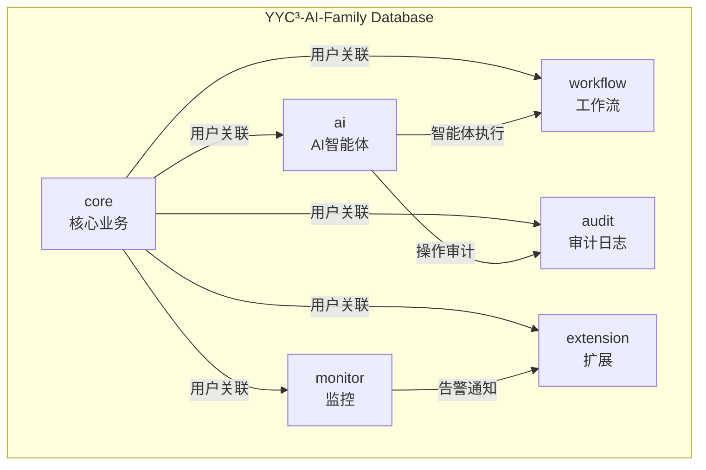

### 1.2 Schema职责矩阵

| Schema | 职责 | 核心实体 | 数据量级 |
|--------|------|----------|----------|
| core | 核心业务数据 | users, roles, permissions, organizations, projects, tasks | 百万级 |
| ai | AI智能体数据 | agents, models, conversations, messages, knowledge_bases | 千万级 |
| workflow | 工作流引擎 | definitions, executions, approval_flows | 百万级 |
| audit | 审计日志 | logs (分区表) | 亿级 |
| monitor | 监控告警 | devices, metrics, alerts, notifications | 亿级 |
| extension | 扩展功能 | plugins, api_keys, webhooks, integrations | 百万级 |

---

## 2. 核心业务Schema ER图

### 2.1 用户权限模型 (RBAC)

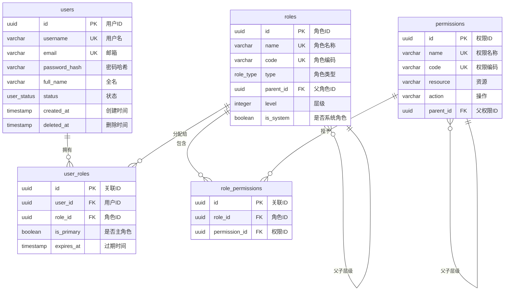

### 2.2 组织架构模型

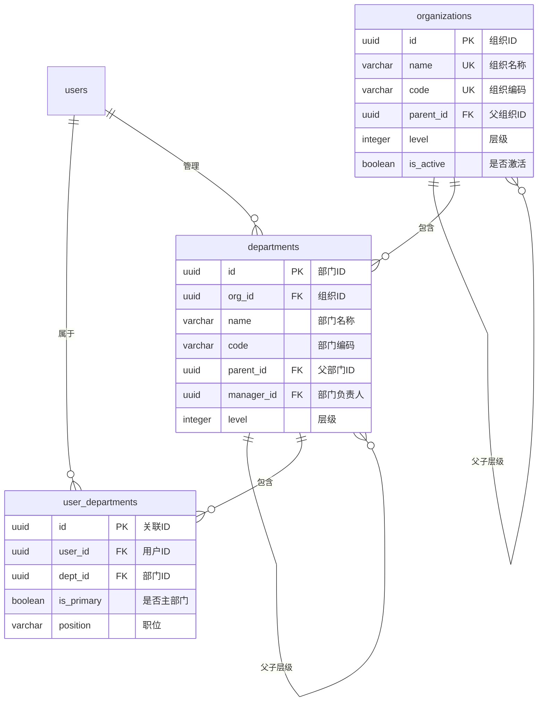

### 2.3 项目任务模型

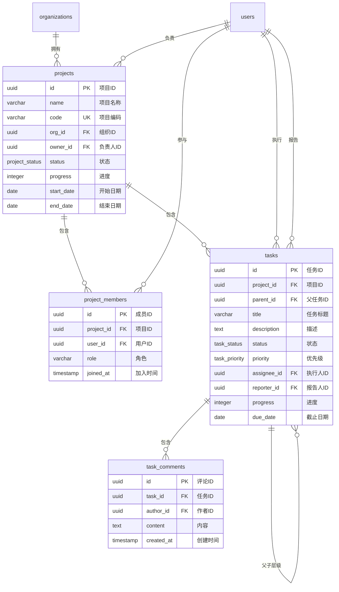

### 2.4 会话管理模型

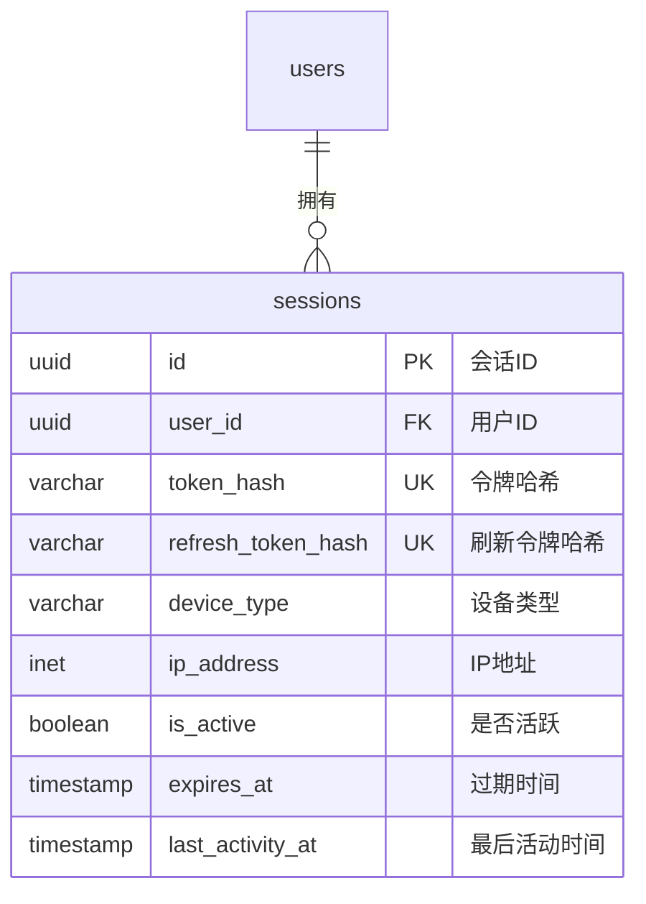

---

## 3. AI智能体Schema ER图

### 3.1 智能体核心模型

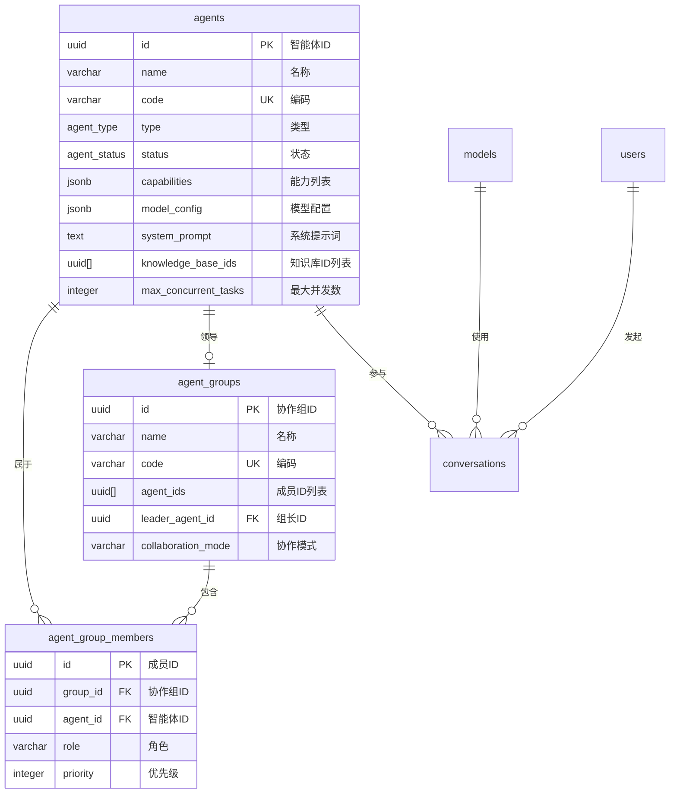

### 3.2 对话消息模型

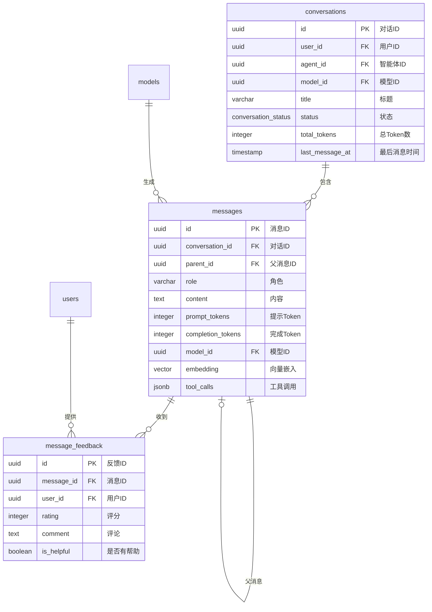

### 3.3 知识库模型

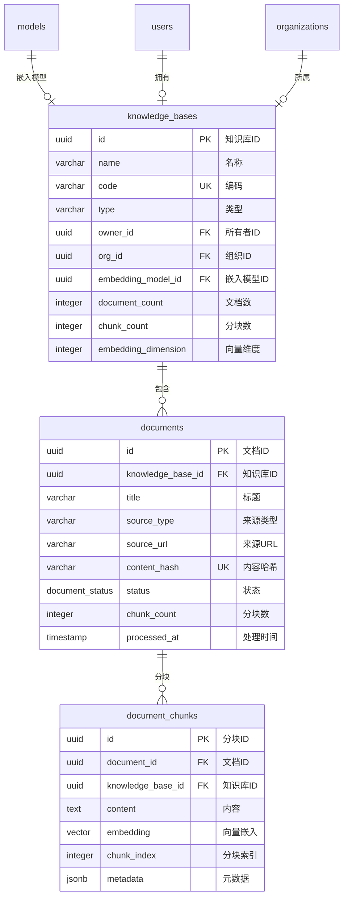

---

## 4. 工作流Schema ER图

### 4.1 工作流执行模型

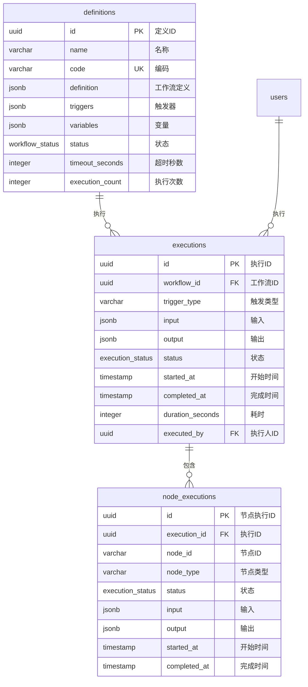

### 4.2 审批流程模型

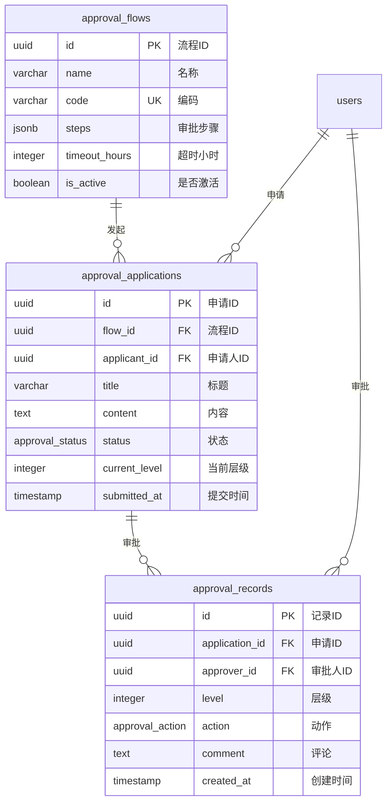

---

## 5. 监控Schema ER图

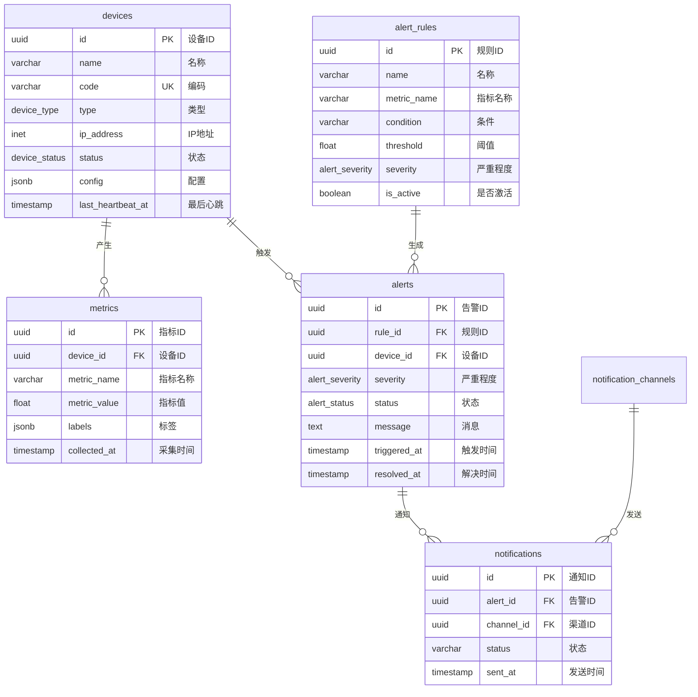

---

## 6. 扩展Schema ER图

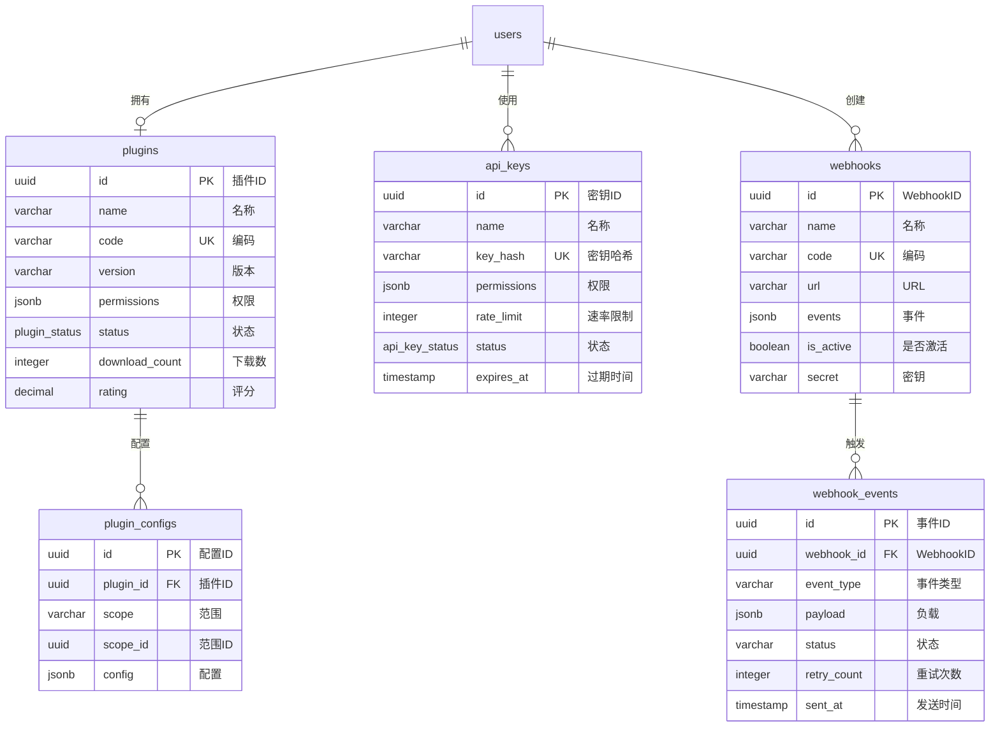

---

## 7. 实体关系汇总

### 7.1 核心实体关系矩阵

| 实体 | 关联实体 | 关系类型 | 说明 |
|------|----------|----------|------|
| users | roles | N:M | 用户拥有多个角色 |
| roles | permissions | N:M | 角色包含多个权限 |
| users | departments | N:M | 用户属于多个部门 |
| users | projects | N:M | 用户参与多个项目 |
| projects | tasks | 1:N | 项目包含多个任务 |
| tasks | tasks | 1:N | 任务有子任务 |
| agents | conversations | 1:N | 智能体参与多个对话 |
| conversations | messages | 1:N | 对话包含多条消息 |
| knowledge_bases | documents | 1:N | 知识库包含多个文档 |
| documents | document_chunks | 1:N | 文档分成多个块 |

### 7.2 跨Schema关系

| 源Schema | 源实体 | 目标Schema | 目标实体 | 关系说明 |
|----------|--------|------------|----------|----------|
| core | users | ai | conversations | 用户发起对话 |
| core | users | ai | knowledge_bases | 用户拥有知识库 |
| core | users | workflow | executions | 用户执行工作流 |
| core | users | audit | logs | 用户操作审计 |
| core | users | extension | api_keys | 用户使用API密钥 |
| ai | agents | workflow | definitions | 智能体定义工作流 |
| monitor | alerts | extension | webhooks | 告警触发Webhook |

---

## 8. 数据流图

### 8.1 用户认证流程

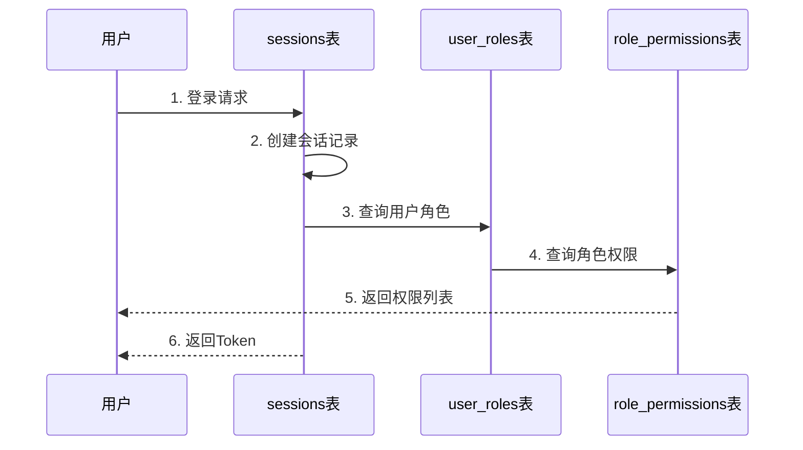

### 8.2 AI对话流程

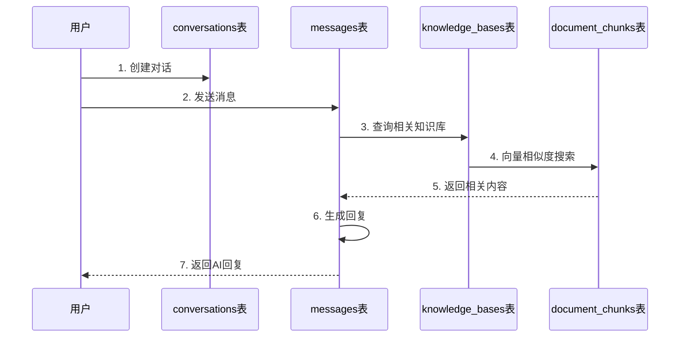

---

> 「***YanYuCloudCube***」
> 「***<admin@0379.email>***」
> 「***Words Initiate Quadrants, Language Serves as Core for Future***」
> 「***All things converge in cloud pivot; Deep stacks ignite a new era of intelligence***」

